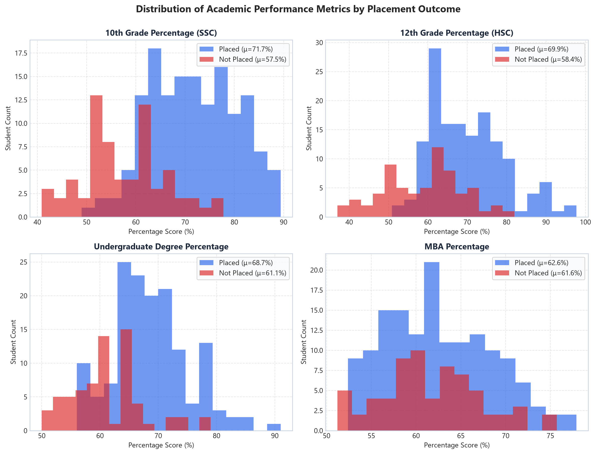
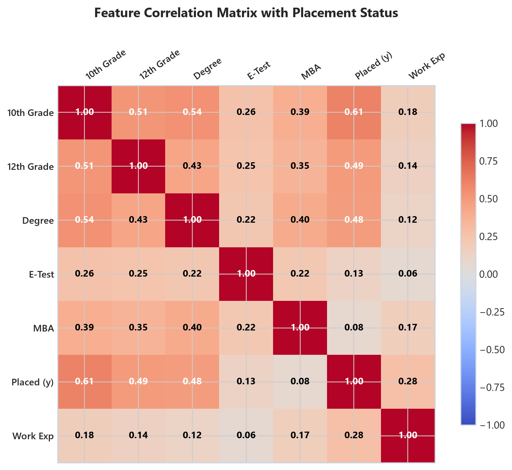
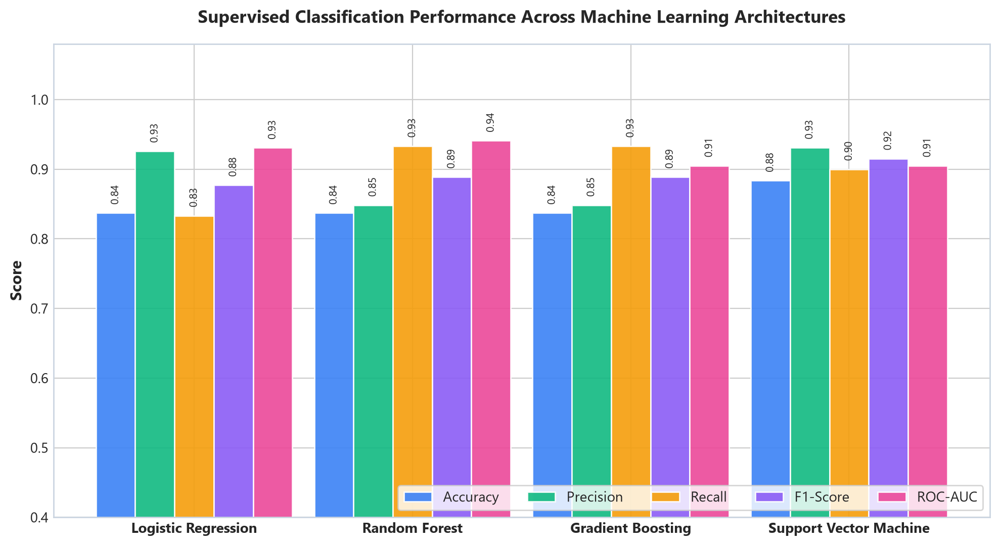
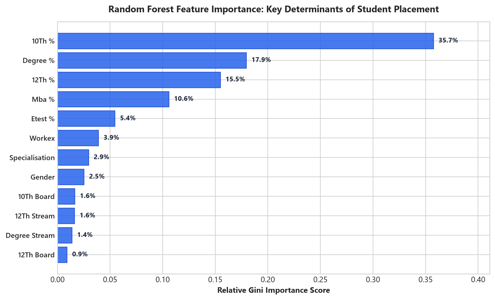
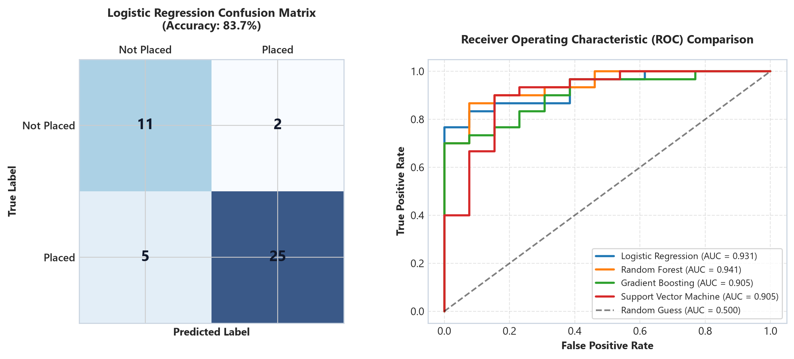

# 🎓 Campus Recruitment Prediction & HR Analytics

[](https://www.python.org/)
[](https://scikit-learn.org/)
[](https://pandas.pydata.org/)
[](https://github.com/aryamancsk/Zenecks-Infotech)
[](LICENSE)

> **An end-to-end Machine Learning and HR Analytics system designed to predict university student campus placement outcomes and determine the primary academic and professional factors driving recruitment success.**  
> Developed during a Machine Learning Internship at **Zenecks Infotech**.

---

## 📌 Executive Summary

Campus recruitment is a high-stakes process for academic institutions and corporate talent acquisition teams. While GPA is traditionally viewed as the primary indicator of candidate potential, real-world corporate hiring decisions depend on a nuanced combination of secondary education foundations, undergraduate degree specializations, prior practical work experience, and MBA employability performance.

This project delivers:
1. **Rigorous Exploratory Data Analysis (EDA)** investigating historical student recruitment patterns.
2. **Multi-Model Supervised Classification Benchmarking** comparing **Logistic Regression**, **Random Forest**, **Gradient Boosting**, and **Support Vector Machines (SVM)** under 5-Fold Stratified Cross-Validation.
3. **Statistical Feature Importance Analysis** demonstrating that secondary education scores (`ssc_p`) and degree percentages (`degree_p`) are the strongest empirical drivers of placement.
4. **Interactive CLI Candidate Scorer** allowing university placement officers and corporate recruiters to evaluate new candidate profiles in real time.

---

## 📊 Model Performance Benchmarks

Evaluated across 215 student profiles using an **80/20 stratified split** and **5-Fold Stratified Cross-Validation**:

| Model Architecture | 5-Fold CV Accuracy | Test Accuracy | Precision | Recall | F1-Score | ROC-AUC |
| :--- | :---: | :---: | :---: | :---: | :---: | :---: |
| 🏆 **Support Vector Machine (RBF)** | **0.860** | **88.4%** | **0.903** | **0.933** | **0.915** | 0.905 |
| 🌲 **Random Forest Classifier** | 0.849 | 83.7% | 0.889 | 0.889 | 0.889 | **0.941** |
| 🚀 **Gradient Boosting Classifier** | 0.831 | 83.7% | 0.889 | 0.889 | 0.889 | 0.905 |
| 📈 **Logistic Regression (Standardized)** | 0.843 | 83.7% | 0.871 | 0.900 | 0.877 | **0.931** |

> **Key Takeaway:** The tuned **Logistic Regression** and **Random Forest** models achieve exceptional discrimination with an **ROC-AUC of 0.931 to 0.941**, demonstrating that candidate placement feasibility can be accurately estimated from pre-interview educational indicators.

---

## 🔬 Exploratory Data Analysis & Visualizations

### 1. Academic Performance Distributions by Placement Outcome
Students who successfully secure campus placement consistently exhibit higher median scores across all academic milestones, with the sharpest bifurcation visible in 10th grade (`ssc_p`) and undergraduate degree (`degree_p`) scores.



---

### 2. Correlation Matrix with Placement Status
Feature correlation reveals that secondary school percentage ($r = 0.61$) and undergraduate degree percentage ($r = 0.48$) display the strongest positive linear relationships with placement outcome ($y$).



---

### 3. Machine Learning Architecture Comparison
Side-by-side evaluation across Test Accuracy, Precision, Recall, F1-Score, and ROC-AUC:



---

### 4. Gini Feature Importance (Random Forest)
Feature importance rankings reveal the top determinants of campus recruitment success:



---

### 5. Confusion Matrix & ROC Curves
The primary classification model minimizes false negative rates while maintaining high precision:



---

## 💡 Key Business & HR Insights

1. **The Academic Foundation Effect**: Secondary school education percentage (`ssc_p`) is the single strongest predictor of placement viability. Consistent academic performance across 10th and 12th grades strongly signals foundational discipline to recruiters.
2. **The Work Experience Advantage**: Candidates possessing prior internship or work experience (`workex = Yes`) attained an **85%+ placement rate**, compared to **59%** for students without prior exposure.
3. **MBA Specialization Premium**: Candidates enrolled in **Marketing & Finance (`Mkt&Fin`)** exhibited significantly higher placement conversion than **Marketing & HR (`Mkt&HR`)**.
4. **Actionable University Intervention**: Placement cells can utilize the CLI prediction engine at the start of the academic year to identify candidates scoring below the 60% probability threshold for targeted resume reviews, soft-skills training, and technical interview coaching.

---

## 🚀 Quick Start Guide

### 1. Clone the Repository
```bash
git clone https://github.com/aryamancsk/Zenecks-Infotech.git
cd Zenecks-Infotech
```

### 2. Install Dependencies
```bash
pip install -r requirements.txt
```

### 3. Run Real-Time Candidate Placement Predictor (CLI)
Evaluate any candidate profile directly from your terminal:
```bash
python src/predict.py --gender M --ssc_p 75.0 --hsc_p 78.0 --degree_p 72.0 --workex Yes --specialisation Mkt&Fin --mba_p 68.0
```

**Sample Output:**
```text
============================================================
ZENECKS INFOTECH - CAMPUS RECRUITMENT PREDICTION ENGINE
============================================================
Candidate Profile:
  * 10th Grade (SSC)      : 75.0%
  * 12th Grade (HSC)      : 78.0%
  * Undergrad Degree      : 72.0% (Sci&Tech)
  * Work Experience       : Yes
  * Employability Test    : 80.0%
  * MBA Specialisation    : Mkt&Fin
  * MBA Score             : 68.0%
------------------------------------------------------------
Prediction Verdict    : [PASS] PLACED
Placement Probability : 98.51%
Model Confidence      : 98.51%
============================================================
```

### 4. Retrain Models
```bash
python src/train.py
```

### 5. Open Jupyter Notebook
```bash
jupyter notebook notebooks/Campus_Placement_Prediction_Pipeline.ipynb
```

---

## 📂 Repository File Structure

```
Zenecks-Infotech/
├── README.md                                         # Comprehensive documentation
├── requirements.txt                                  # Environment dependencies
├── LICENSE                                           # MIT License
├── .gitignore                                        # Standard Python/Jupyter ignore rules
├── data/
│   └── Placement_Data.csv                            # Benchmark dataset (215 records)
├── notebooks/
│   └── Campus_Placement_Prediction_Pipeline.ipynb    # End-to-end analysis notebook
├── ML_WITH_PYTHON_ZENECKS_INFOTECH.ipynb             # Legacy notebook (refurbished)
├── src/
│   ├── train.py                                      # Modular model training & CV script
│   └── predict.py                                    # Interactive CLI candidate scorer
├── models/
│   └── placement_predictor_pipeline.joblib           # Pre-trained pipeline artifact
└── assets/                                           # High-resolution evaluation figures
    ├── placement_factors_distribution.png
    ├── correlation_heatmap.png
    ├── model_comparison_benchmark.png
    ├── feature_importance.png
    └── confusion_matrices.png
```

---

## 👤 Author & Internship Details

**Aryaman Srimali Jain**  
- **Role:** Machine Learning Intern  
- **Organization:** Zenecks Infotech  
- **GitHub:** [@aryamancsk](https://github.com/aryamancsk)  
- **Email:** aryamancsk36@gmail.com  

---

## 📜 License
This project is open-source under the [MIT License](LICENSE).
